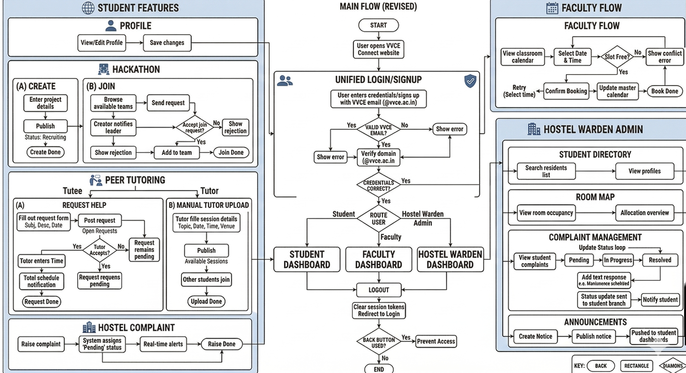

# 🌐 VVCE Connect — Unified Campus Portal

### [🚀 View Live Demo](https://vvce-connect-six.vercel.app)

[](https://nextjs.org/)
[](https://www.typescriptlang.org/)
[](https://supabase.com/)
[](https://tailwindcss.com/)
[](LICENSE)

**VVCE Connect** is a secure, role-based campus portal designed for **Vidyavardhaka College of Engineering (VVCE)**. It solves core academic and administrative logistics by unifying Controller of Examinations (COE) scheduling, faculty duty swapping, hostel management, peer-to-peer tutoring, and student hackathon collaboration into a single, cohesive web platform.

---

## 💡 Core Engineering Highlights

*   **Granular Role-Based Access Control (RBAC)**: Custom middleware routes and views for 6 distinct roles: **Admin, Student, Faculty, HOD, Warden, and COE**.
*   **State-Driven Multi-Stage Approvals**: A seamless **Exam Invigilation Swap Workflow** where faculty request duty swaps, progressing automatically through target faculty confirmation ➡️ HOD approval ➡️ COE final sign-off.
*   **Advanced Row Level Security (RLS)**: Fine-grained PostgreSQL RLS policies in Supabase to restrict read/write access to authorized user scopes.
*   **Transactional Notifications**: In-app alerts and transactional email dispatches using **Resend** for instant duty updates and magic logins.

---

## 🗺️ System Workflow Architecture



---

## ✨ Feature Matrix

| Dashboard / Role | Key Features |
| :--- | :--- |
| **🎓 Student** | Hostel outpass/complaints, Peer tutoring matching, Hackathon team finder, Skill profile |
| **👩‍🏫 Faculty** | Live invigilation schedules, peer-to-peer duty swap requests |
| **📝 HOD** | Departmental invigilation oversight, first-line approval for duty swaps |
| **🎓 COE** | Exam schedule manager, room allocator, live duty board, final swap authorizer |
| **🏠 Warden** | Hostel room/bed allotments, residential announcements, student complaint resolver |
| **🛠️ Admin** | System auditing, user account role upgrades, database logging |

---

## 🚀 Quick Setup & Installation

### 1. Clone & Install Dependencies
```bash
git clone https://github.com/vidyavarshinig15/Vvce-connect.git
cd Vvce-connect
npm install
```

### 2. Configure Environment
Create a `.env.local` file in your root folder:
```env
NEXT_PUBLIC_SUPABASE_URL=your-supabase-url
NEXT_PUBLIC_SUPABASE_ANON_KEY=your-supabase-anon-key
SUPABASE_SERVICE_ROLE_KEY=your-supabase-service-role-key
RESEND_API_KEY=your-resend-api-key # Optional locally
```

### 3. Initialize Database
Navigate to your Supabase SQL Editor and run the SQL scripts stored in the [`database/`](file:///Users/vidyavarshini/Desktop/Vvce-connect-main/database) folder in this order:
1.  [`schema.sql`](file:///Users/vidyavarshini/Desktop/Vvce-connect-main/database/schema.sql)
2.  [`exam_allotment_queries.sql`](file:///Users/vidyavarshini/Desktop/Vvce-connect-main/database/exam_allotment_queries.sql)
3.  Apply incremental schema updates: `coe_schema_update.sql`, `exam_schema_updates.sql`, `workflow_schema_updates.sql`, `fix_exam_allotments_rls.sql`, `fix_notifications_rls.sql`.

### 4. Run Development Server
```bash
npm run dev
```
Open [http://localhost:3000](http://localhost:3000) to view the portal.

---

## 📤 Production Deployment

### Vercel Frontend
1.  Connect your GitHub repository to **Vercel**.
2.  Add your `.env.local` keys under Vercel's Environment Variables.
3.  Deploy! Vercel automatically detects Next.js build settings.

### Supabase Backend
Ensure your live Vercel URL (e.g., `https://vvce-connect-six.vercel.app`) is added to the **Redirect URLs** in **Supabase Dashboard > Authentication > URL Configuration** to enable production authorization callbacks.

---

## 📄 License
Distributed under the MIT License. See `LICENSE` for details.
